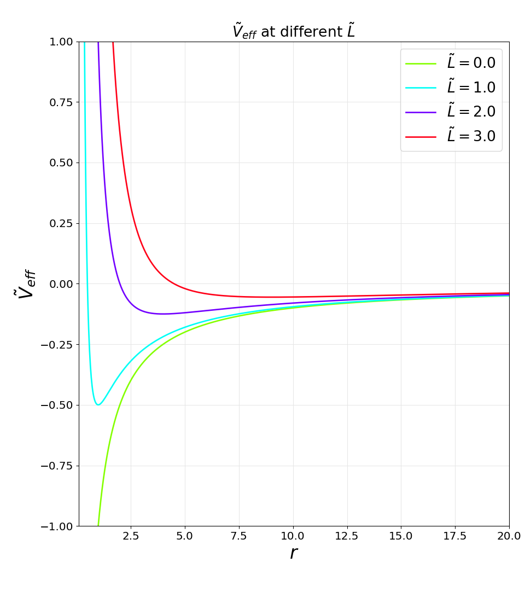

# planetary motions 

## Newton 

### Lagrangian approach 

In polar coordinates the [kinetic energy](#kinetic-energy-in-polar-coordinates) $T$ and potential energy $V$  read : 

$$
\begin{eqnarray}
T &=& \frac{1}{2}m\dot r^2 + \frac{1}{2}mr^2\dot{\theta}^2  \\
V &=& -\frac{mMG}{r}
\end{eqnarray}
$$

The equation of movement from [Euler-Lagrange](/Lagrangian_mechanics/#lagrangian-mechanics) equations for the Lagrangian $\tilde{\mathcal L} = \tilde T - \tilde V$ (where $\tilde{\square}$ refers to $\square/m$) applied with coordinate $\theta$ give  :  

$$
\frac{d}{dt}\left(\frac{\partial \tilde{\mathcal L}}{\partial \dot\theta}\right) - \frac{\partial\tilde{\mathcal L}}{\partial \theta} = \frac{d r^2\dot\theta}{dt} = 0 
\Rightarrow  \frac{d}{dt} \tilde L = 0 \Rightarrow \tilde L = r^2\dot\theta
$$
which is the conservation of angular momentum $\tilde L$.
The rotational part of the kinetic energy becomes $\tilde T_{\theta} = L^2/2r^2$ so that Euler-Lagrange on r gives : 

$$ 
\begin{eqnarray}
    \frac{d}{dt}\left(\frac{\partial \tilde L}{\partial \dot r}\right) - \frac{\partial\tilde L}{\partial r} &=& 0 \Rightarrow
    \ddot r &=& - \frac{d}{dr}\left(-\frac{k}{r} + \frac{\tilde L^2}{2r^2}\right) = -\frac{d}{dr}\tilde V_{eff}
\end{eqnarray}
$$ 

### Effective potential 

We can then define an effective potential $\tilde V_{eff}$ which includes the $r$-dependent rotational kinetic energy term : 

$$ 
    \tilde V_{eff} = - \frac{k}{r} + \frac{\tilde L^2}{2r^2}
$$ 

where $k=MG$. 

Since the total energy must be conserved $\tilde E = \tilde T+\tilde V = \frac{\dot r^2}{2}+\tilde V_{eff}$ we have  : 

$$
    \left(\frac{dr}{dt}\right)^{2} = \tilde E-\tilde V_{eff} \geq 0
$$

hence the total energy $\tilde E$ must always be above the effective potential $\tilde V_{eff}$ and these are only equal when there is no momentum along the radial direction.

$\tilde V_{eff}$ | $$ | $$
------------------ | ------------------ | ------------------
 | |  |

## GR 

The for the Newtonian limit ([weak field theory](#weak-field-theory)) yields the metric : 

$$
    \mathrm{ds}^2 = -(1-2k/r)\mathrm{dt}^2 + (1+2k/r)\mathrm{dr}^2 + r^2\mathrm d\Omega^2
$$ 

### Constants of motion

The [equation of geodesics](geodesics.md) in its lower index form gives  : 
$$  
    \frac{dg_{\alpha\beta} \dot x^{\alpha}}{d\tau} = \frac{1}{2}g_{\mu\nu,\beta}\dot x^{\mu}\dot x^{\nu}
$$

The time coordinate $x^{\beta}=t$ yields that the energy is constant on the trajectory: 
$$
    g_{tt}\frac{dt}{d\tau} = \frac{p_0}{m} = \tilde E
$$
Note that this energy is the one measured from a static distant observer. The energy measured in the moving frame  

Used along both $\theta$ and $\phi$ we get that the movement is restricted to a plane (for example $\theta=\pi/2$) 
and the angular momentum is constant along the trajectory : 

 
$$
    g_{\phi\phi}\frac{d\phi}{d\tau} = \frac{p_{\phi}}{m} = \tilde L
$$

### Equation of motion

The equation of motion can be obtained from the invariance of the 4-momentum norm $-m^2 = g_{\mu\nu} p^{\mu}p^{\nu}$ where $\mathbf p=m\mathbf u=m(dt/d\tau,dr/d\tau,0,d\phi/d\tau)$. Since $m$ is constant, it can also be written for the 4-velocity :

$$
    g^{tt}\tilde E^2 + g_{rr}\left(\frac{dr}{d\tau}\right)^2 + \frac{\tilde L^2}{r^2} = - 1
$$

In general relativity, the total energy includes the mass of the particle so that $E=m+E_{newton}$. 
For slow particles $v\ll 1$, the Newtonian kinetic energy is way smaller that the rest energy $E_{newton}\ll m$  so that $\tilde E^2\approx 1 + 2\tilde E_{newton}$. 

### Purely Newtonian limit 

By definition of weak field theory, the classical Newtonian field $k/r\ll 1$ so that $g^{tt}\approx 1+2k/r$. 
We know that for Newtonian planetary orbits that $\tilde E_{newton}$ is on the same order of magnitude that the classical Newtonian field $k/r$.
We also know that the angular momentum energy term $\frac{\tilde L^2}{r^2}$ is also comparable to $\tilde E_{newton}$ and $k/r$.

Finally, we also have $(dr/d\tau)^2=v_r^2$ also comparable to $\tilde E_{newton}$ and $k/r$ which is consistent with the fact that $v\ll 1$.
This means that the field perturbation of the metric term $g_{rr}$ is of second order. 

As a result the first oder classical Newtonian field solely comes from the time curvature term of the metric :   

$$
    g^{tt}\tilde E^2 \approx -\left(1+\frac{2k}{r}\right)\left(1+2\tilde E_{newton}\right) 
    \approx -1 -\frac{2k}{r} -2\tilde E_{newton}
$$

Injecting this into the equation of motion and dividing by 2 gives the energy relationship of the classical Newtonian equation of planetary motions : 

$$
   \frac{1}{2}\left(\frac{dr}{d\tau}\right)^2 = \tilde E_{newton} - \left(-\frac{k}{r} + \frac{\tilde L^2}{2r^2} \right)
$$

### higher order correction

If we do not neglect the higher order term due to spatial curvature 

$$
\begin{eqnarray}
     -\tilde E^2\left(1-\frac{2k}{r}\right)^{-1} + \left(1+\frac{2k}{r}\right)\left(\frac{dr}{d\tau}\right)^2 + \frac{\tilde L^2}{r^2} = - 1 \\
     \left(\frac{1}{2}\frac{dr}{d\tau}\right)^2  = \frac{\tilde E^2 - 1}{2} + \frac{k}{r} - \frac{\tilde L^2}{2r^2}\left(1-\frac{2k}{r}\right)
\end{eqnarray}
$$

$$
    \frac{1}{2}\left(\frac{dr}{d\tau}\right)^2  = \tilde E_{newton} - \left(-\frac{k}{r} + \frac{\tilde L^2}{2r^2}\left(1-\frac{2k}{r}\right)\right)
$$

where we can see that general relativity adds a correction term $-k\tilde L^2/r^3$ to the effective potential of the purely Newtonian case.  
This equation would quite remarkably hold even in the strong field regime of the Schwartschild metric.

## Appendix 
### kinetic-energy in polar coordinates

